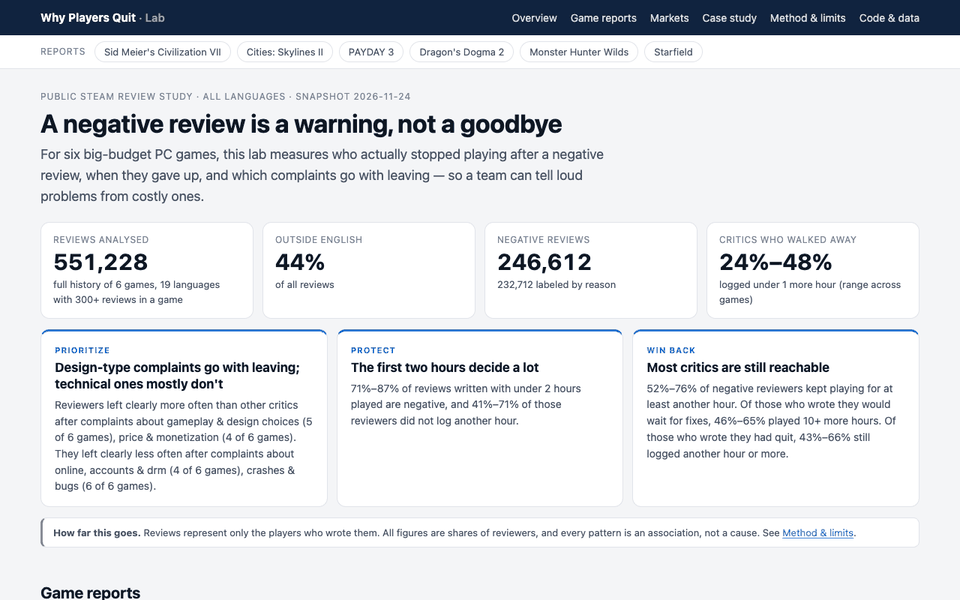

# Player Signals

- **What:** a study of what players do after they review a Steam game, recommended or not, built from 551,228 public Steam reviews of six games in every language. One page covers why players quit.
- **Finding:** 6% of players who recommend a game log under one more hour after reviewing; 32% of critics do, at every stage of play. Among critics, players who report crashes mostly keep playing; every other complaint type goes with stopping more often. English reviews alone can hide a whole market (Monster Hunter Wilds: 29% negative in English, 78% in Simplified Chinese).
- **How:** Steam shows playtime at review and playtime now. The gap shows what each reviewer did *after* complaining.

**Site:** https://hosungkim48.github.io/whyplayersquit-lab/ · **Case study:** [the review score that hid a market](https://hosungkim48.github.io/whyplayersquit-lab/case-study.html)



Built with an AI agent (Claude). A free, public student research project, not affiliated with Valve or any studio or publisher.

## What is here

| Path | What it is |
|---|---|
| `docs/` | The published site. `docs/data/*.json` holds every number shown. |
| `data/public/` | The same numbers as CSV tables, plus the cost ledger and row counts per stage. |
| `src/` | All code: fetch → clean → label → analyze → build site → verify. |
| `DATA.md` | Files, columns, quirks. |
| `SUMMARY.md` | What was built, why, cost, judgment calls. |

Raw reviews (text and reviewer IDs) are not in this repository and are never published.

## Run order

```
cd src
python3 fetch_reviews.py english && python3 fetch_reviews.py other
python3 fetch_news.py && python3 fetch_lifetime_summary.py
python3 build_dataset.py
python3 label.py <appid>          # English; run_labeling_other.sh for other languages
python3 sublabel.py               # design sub-reasons, Civilization VII
python3 quotes.py && python3 audit_sample.py && python3 audit.py
python3 analyze.py && python3 after_review.py && python3 fans.py && python3 cost.py && python3 build_site.py
python3 make_media.py && python3 verify.py
```

## Limits

- Reviews represent only the players who wrote them.
- All patterns are associations. Nothing here shows that a complaint caused a player to leave.
- Reason labels come from a language model and were checked by a second model, not by people.
